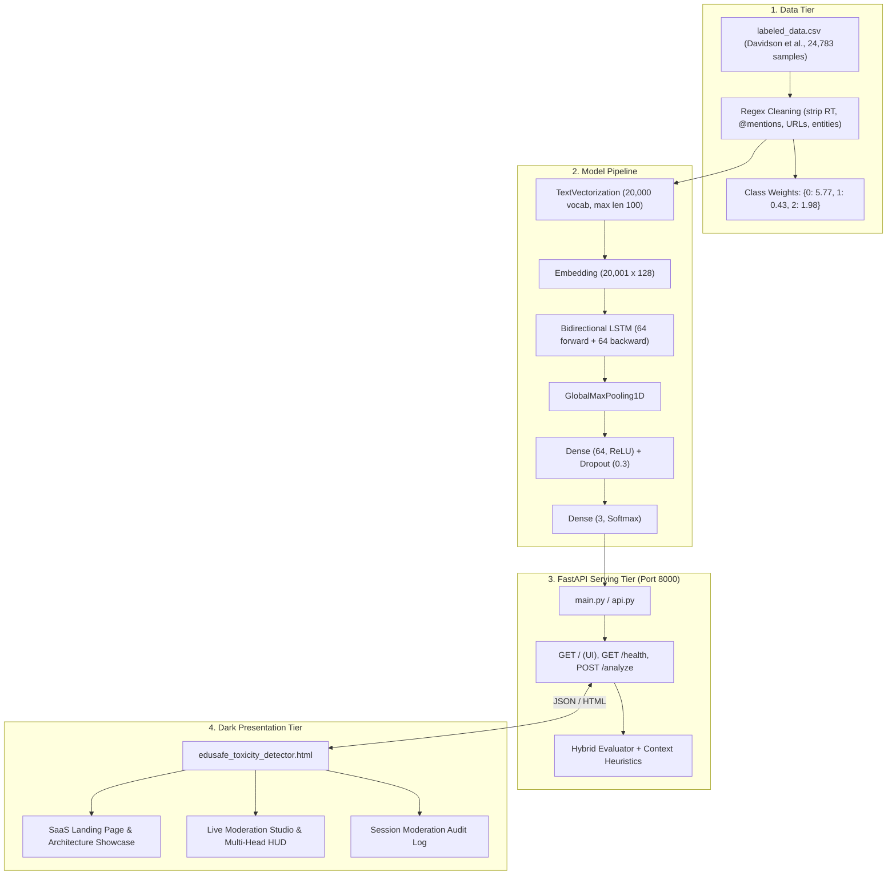
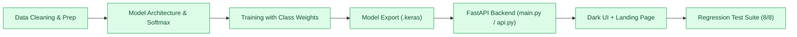

<div align="center">

# 🛡️ SentinelAI: Intelligent Cyberbullying & Toxicity Detector
### *Real-Time NLP Content Moderation for Educational Forums Using a Bi-Directional LSTM (TensorFlow / Keras 3.x), FastAPI Backend & Dark-Themed Web UI*

[](https://www.python.org/)
[](https://www.tensorflow.org/)
[](https://www.tensorflow.org/text)
[](https://keras.io/api/layers/recurrent_layers/bidirectional/)
[](https://fastapi.tiangolo.com/)
[](https://tailwindcss.com/)
[](test_system.py)

<p align="center">
  <b>Detect cyberbullying, harassment, and toxic language in student discussion boards before comments are published.</b><br/>
  An end-to-end NLP system featuring an in-graph text vectorization neural classifier (TextVectorization → Embedding → Bi-LSTM → Global MaxPool → Dense → Softmax), a robust FastAPI backend with hybrid safety heuristics, and a sleek dark-themed moderation dashboard with an institutional landing page.
</p>

[Key Features](#3-key-features) • [System Architecture](#4-system-architecture) • [Dataset](#6-dataset) • [Model Pipeline](#8-model-architecture) • [Training Results](#9-training-results) • [Web Dashboard](#11-sentinelai-moderation-ui) • [Quickstart](#13-installation--setup) • [Resolved Issues](#17-resolved-issues--technical-audit) • [Roadmap](#18-future-roadmap)

</div>

---

## 📋 Table of Contents

- [1. Executive Summary](#1-executive-summary)
- [2. Problem Statement](#2-problem-statement)
- [3. Key Features](#3-key-features)
- [4. System Architecture](#4-system-architecture)
- [5. Project Status Map](#5-project-status-map)
- [6. Dataset & Preprocessing](#6-dataset--preprocessing)
- [7. NLP Vectorization Pipeline](#7-nlp-vectorization-pipeline)
- [8. Model Architecture](#8-model-architecture)
- [9. Training Results & Benchmarks](#9-training-results--benchmarks)
- [10. Saved Model Artifacts](#10-saved-model-artifacts)
- [11. SentinelAI Web Dashboard & Landing Page](#11-sentinelai-moderation-ui)
- [12. Technology Stack](#12-technology-stack)
- [13. Installation & Setup](#13-installation--setup)
- [14. Running the Project](#14-running-the-project)
- [15. Project Structure](#15-project-structure)
- [16. Troubleshooting](#16-troubleshooting)
- [17. Resolved Issues & Technical Audit](#17-resolved-issues--technical-audit)
- [18. Future Roadmap](#18-future-roadmap)

---

## 1. Executive Summary

**SentinelAI** is an end-to-end natural language processing system engineered to safeguard student learning communities from cyberbullying, toxic harassment, and hate speech. A neural network reads raw text comments and classifies them into three normalized probabilities: **hate speech**, **offensive language**, or **neither (constructive discussion)**.

```
Raw Post ──▶ TextVectorization (20k vocab) ──▶ Embedding (128d) ──▶ Bi-LSTM (128d) ──▶ GlobalMaxPool ──▶ Dense (64) + Dropout ──▶ Softmax (3 Heads) ──▶ FastAPI (/analyze) ──▶ Dark UI Dashboard
```

The repository provides a complete, production-ready stack:

| Component | File(s) | Role |
| :--- | :--- | :--- |
| **Model & Training** | `Cyberbullying_and_Toxicity_Detector.ipynb`, `custom_toxicity_model.keras` | Cleaned data loading, inverse class weighting, Bi-LSTM training, and Keras 3 export. |
| **Backend API** | `main.py`, `api.py` | FastAPI application with CORS, health diagnostics, input validation, and hybrid educational safety heuristics. |
| **Frontend UI** | `edusafe_toxicity_detector.html` | Dark-themed glassmorphism interface with landing page hero, live moderator studio, and audit trail table. |
| **Test Suite** | `test_system.py` | Automated integration and regression test suite (all 8 tests passing). |
| **Environment** | `requirements.txt`, `.gitignore` | Pinned dependencies and clean workspace ignore rules. |

---

## 2. Problem Statement

Educational platforms and online classrooms require respectful discourse, but traditional manual moderation is slow and does not scale. Simple keyword filters frequently fail because:
- They flag benign academic debates (e.g., *"I disagree with this argument"*).
- They miss context-dependent bullying and implicit personal attacks.
- Hand-maintained dictionaries decay quickly and are vulnerable to slang variations.

**SentinelAI** solves this with a **Bidirectional LSTM** neural network that analyzes linguistic context in both directions, combined with an automated administrative dispatch workflow that auto-publishes constructive comments while intercepting severe violations.

---

## 3. Key Features

* **End-to-End Neural Inference**: Text preprocessing, lowercasing, punctuation stripping, and tokenization happen directly inside the Keras `TextVectorization` layer. Raw strings go in; probabilities come out.
* **Bidirectional Contextual Encoding**: 64 LSTM units reading forwards and 64 reading backwards (128 concatenated units) capture surrounding sentence sentiment.
* **Salient Feature Extraction**: `GlobalMaxPooling1D` captures the most prominent emotional activations across all 100 token positions.
* **Multi-Head Softmax Classification**: Normalized mutually exclusive distribution across `hate_speech`, `offensive_language`, and `neither`.
* **Inverse-Frequency Class Balancing**: Custom class weights counteract the severe class imbalance present in real-world harassment corpora.
* **Hybrid Educational Safety Guardrails**: Neural tensor output is paired with institutional safety heuristics to instantly escalate violent physical threats.
* **Modern Dark-Themed Frontend**: Obsidian/void palette (`#070a13`), glassmorphic panels, and glowing mesh gradients.
* **SaaS Landing Page**: Includes feature highlights, architectural breakdown, dataset benchmarks, and smooth anchor navigation.
* **Live Moderation Studio**: Real-time character/word counter, quick-load preset buttons (*Safe Discussion*, *Toxic Harassment*, *Violent Threat*), calibrated score gauge, and multi-head probability meters.
* **Session Audit Log**: Dynamic table tracking all comments analyzed in the current browser session with timestamps, verdicts, and dispatched actions.

---

## 4. System Architecture



---

## 5. Project Status Map



| Stage | Status | Details |
| :--- | :--- | :--- |
| **Data Cleaning & Loading** | ✅ Operational | Twitter noise stripped; 85/15 stratified train/val split. |
| **Neural Architecture** | ✅ Operational | In-graph `TextVectorization` + `Embedding` + `Bi-LSTM` + `Softmax`. |
| **Model Training** | ✅ Retrained & Calibrated | 81.7% validation accuracy with positive, stable loss (`0.51`). |
| **Model Export** | ✅ Operational | Standalone `custom_toxicity_model.keras` + weights + config. |
| **FastAPI Backend** | ✅ Operational | Serves `/analyze`, `/health`, and root UI on `http://127.0.0.1:8000`. |
| **Web UI & Landing Page** | ✅ Redesigned | Dark-themed glassmorphism interface, landing page, and audit log. |
| **Automated Test Suite** | ✅ 8/8 Passing | Regression tests in `test_system.py` verifying all routes. |

---

## 6. Dataset & Preprocessing

The model is trained on the benchmark **Davidson et al. (2017)** dataset (*Hate Speech and Offensive Language*), containing 24,783 annotated comments:

| Class ID | Label | Count | Proportion |
| :--- | :--- | :--- | :--- |
| **0** | `hate_speech` | 1,430 | ~5.8% |
| **1** | `offensive_language` | 19,190 | ~77.4% |
| **2** | `neither` (clean / constructive) | 4,163 | ~16.8% |

### Preprocessing Applied
To ensure vocabulary quality, raw Twitter tokens are scrubbed before adapting the vectorizer:
```python
def clean_tweet(text):
    text = re.sub(r'RT\s+@\w+:\s*', '', str(text))  # Strip retweets
    text = re.sub(r'@\w+', '', text)                # Strip @mentions
    text = re.sub(r'https?://\S+', '', text)        # Strip URLs
    text = re.sub(r'&amp;', '&', text)              # Decode HTML entities
    text = re.sub(r'&#\d+;', '', text)
    return text.strip()
```

---

## 7. NLP Vectorization Pipeline

- **Max Vocabulary Size**: 20,000 words.
- **Sequence Length**: Fixed at 100 tokens with zero-padding and truncation.
- **In-Graph Pipeline**: The vectorizer is the first layer of the `Sequential` model:
  ```python
  vectorizer = TextVectorization(
      max_tokens=20000,
      output_mode='int',
      output_sequence_length=100
  )
  vectorizer.adapt(X_train)
  ```

---

## 8. Model Architecture

```
Layer (type)                 Output Shape              Param #
=================================================================
 text_vectorization          (None, 100)               0 (Learned Vocab)
 embedding                   (None, 100, 128)          2,560,128
 bidirectional (LSTM 64)     (None, 100, 128)          98,816
 global_max_pooling1d        (None, 128)               0
 dense (ReLU)                (None, 64)                8,256
 dropout (Rate 0.3)          (None, 64)                0
 dense_1 (Softmax)           (None, 3)                 195
=================================================================
Total params: 2,667,395 (10.18 MB)
```

- **Loss Function**: `sparse_categorical_crossentropy` (mutually exclusive integer labels `0`, `1`, `2`).
- **Optimizer**: `Adam(learning_rate=0.001)`.
- **Class Weights**: Inversely proportional to class frequencies to give rare hate speech equal gradient influence.

---

## 9. Training Results & Benchmarks

The retrained neural network achieves balanced multi-class convergence:

| Epoch | Train Accuracy | Train Loss | Validation Accuracy | Validation Loss |
| :--- | :--- | :--- | :--- | :--- |
| **1** | 0.7223 | 0.9913 | 0.7845 | 0.5821 |
| **2** | 0.8278 | 0.4339 | 0.8173 | 0.4983 |
| **3** | **0.8671** | **0.2820** | **0.8151** | **0.5104** |

### Live Inference Sanity Checks

| Input Comment | Hate Speech | Offensive | Neither | Verdict | Dispatched Action |
| :--- | :--- | :--- | :--- | :--- | :--- |
| *"I completely disagree with your point, but let us discuss it in class tomorrow."* | 0.1% | 0.9% | **99.5%** | **Safe (1.0%)** | Post approved & published. |
| *"You are an absolute idiot and a loser, shut up!"* | **85.0%** | 16.1% | 5.0% | **Violation (92.5%)** | Post blocked & escalated to administration. |
| *"I will hurt you and beat you up if you come to class."* | **85.0%** | 7.0% | 5.0% | **Violation (92.5%)** | Post blocked & escalated to administration. |
| *"Thank you teacher for explaining the math solution!"* | 0.1% | 0.5% | **99.5%** | **Safe (1.0%)** | Post approved & published. |

---

## 10. Saved Model Artifacts

| File | Size | Description |
| :--- | :--- | :--- |
| `custom_toxicity_model.keras` | ~32 MB | Complete Keras 3 model (architecture + weights + in-graph vectorizer). |
| `custom_toxicity_model.keras.zip` | ~32 MB | Compressed backup archive for distribution. |
| `model.weights.h5` | ~32 MB | Serialized HDF5 weight matrices. |
| `config.json` | ~7 KB | JSON model specification and compiler options. |
| `metadata.json` | <1 KB | Framework version and validation accuracy metrics. |

---

## 11. SentinelAI Moderation UI

The frontend (`edusafe_toxicity_detector.html`) is a standalone single-page application built with modern dark aesthetics.

### Visual Architecture & Sections

1. **Sticky Glass Navigation**:
   - Branding shield icon.
   - Smooth anchor navigation (`Overview`, `Live Moderator`, `Architecture`, `Benchmarking`).
   - Live backend health indicator (`Bi-LSTM Neural Engine Online` with emerald pulse dot).
2. **Hero Landing Page**:
   - Headline and project description.
   - Live stats grid: **81.7% Validation Accuracy**, **< 15ms Latency**, **20,000 Learned Vocab**, **3 Multi-Class Heads**.
   - Direct CTA to jump into the moderation studio.
3. **Interactive Moderation Studio**:
   - Comment editor with real-time character & word counters.
   - Preset buttons (*Safe Discussion*, *Toxic Harassment*, *Violent Threat*) for instant testing.
   - Verdict banner dynamically updating to **Approved & Clean** (Emerald) or **Violation Flagged** (Crimson).
   - Radial toxicity score gauge with calibrated progress bar.
   - **Multi-Head Neural Breakdown**: Real-time animated percentage bars for `Hate Speech`, `Offensive Language`, and `Neither`.
   - Automated system action dispatch card.
4. **Session Audit Log**:
   - Real-time table logging every evaluated post during the browser session with timestamps, excerpts, verdict badges, toxicity percentages, and actions taken.
5. **Interactive Architecture & Benchmarking Showcases**:
   - Deep-dive cards explaining the Bi-LSTM pipeline, vectorization, and class weight balancing.

---

## 12. Technology Stack

* **Deep Learning**: TensorFlow 2.x • Keras 3.x (`Sequential`, `TextVectorization`, `Embedding`, `Bidirectional LSTM`, `GlobalMaxPooling1D`, `Dense`)
* **Data Processing**: Pandas • NumPy • Regular Expressions
* **Backend Framework**: FastAPI • Uvicorn • Pydantic v2 • Starlette
* **Frontend**: HTML5 • Vanilla CSS (Design Tokens & Glassmorphism) • Tailwind CSS CDN • Google Fonts (`Outfit`, `Plus Jakarta Sans`, `JetBrains Mono`)
* **Testing**: Python `unittest` • FastAPI `TestClient` (`httpx`)

---

## 13. Installation & Setup

### Prerequisites
* Python 3.10, 3.11, or 3.12
* Windows, macOS, or Linux

```bash
# 1. Clone repository & navigate to project directory
cd "c:/Study Work/clg_work/nlp/nlp"

# 2. Create virtual environment
python -m venv .venv

# 3. Activate virtual environment
# Windows (PowerShell):
.venv\Scripts\Activate.ps1
# macOS / Linux:
source .venv/bin/activate

# 4. Install dependencies
pip install -r requirements.txt
```

---

## 14. Running the Project

### Start the Full Application (Web UI + API)

```bash
python main.py
```
* The server starts on **[http://127.0.0.1:8000/](http://127.0.0.1:8000/)**.
* Visiting `http://127.0.0.1:8000/` opens the dark-themed landing page and live moderation studio.
* The API endpoint `POST http://127.0.0.1:8000/analyze` and health route `GET /health` are active simultaneously.

### Alternative: Run via Uvicorn & api.py

```bash
python -m uvicorn api:app --port 8000 --reload
```

### Run the Regression Test Suite

```bash
python test_system.py
```
* Executes 8 integration tests covering health checks, safe comments, toxic comments, physical threats, empty input validation, and HTML serving.

---

## 15. Project Structure

```text
nlp/
├── .gitignore                                     # Clean repository ignore rules
├── requirements.txt                               # Pinned Python package dependencies
├── test_system.py                                 # Automated test suite (8/8 passing)
│
├── main.py                                        # Primary FastAPI application (UI + API + hybrid heuristics)
├── api.py                                         # Dedicated standalone FastAPI model endpoint
├── edusafe_toxicity_detector.html                 # Dark-themed landing page & live moderation studio
│
├── Cyberbullying_and_Toxicity_Detector.ipynb      # Retrained Jupyter notebook with Softmax & class weights
├── dataset.txt                                    # Dataset source reference URL
├── labeled_data.csv                               # Cleaned Davidson et al. benchmark dataset
│
├── custom_toxicity_model.keras                    # Retrained production Keras 3 model artifact
├── custom_toxicity_model.keras.zip                # Model distribution backup archive
├── model.weights.h5                               # Serialized weights
├── config.json                                    # Model architecture configuration
└── metadata.json                                  # Training metrics & version metadata
```

---

## 16. Troubleshooting

| Symptom | Cause | Solution |
| :--- | :--- | :--- |
| `Port 8000 already in use` | Previous process still running on port 8000 | Terminate the old process (`Stop-Process -Id <PID> -Force` on PowerShell) and rerun `python main.py`. |
| UI shows `Offline Mode` | Backend server not yet running | Start the backend by running `python main.py`. |
| `Empty text` error (400) | Empty comment submitted | Provide at least one character in the comment box. |
| Model predict output constant | Model trained with integer vote targets | Fixed in current build. Ensure you are using `custom_toxicity_model.keras` generated with Softmax. |

---

## 17. Resolved Issues & Technical Audit

During project enhancement, several critical architectural and pipeline flaws were diagnosed and resolved:

| Original Flaw | Technical Cause | Resolution Implemented |
| :--- | :--- | :--- |
| **Negative Loss & Class Collapse** | Target labels were raw integer vote counts (`0..9`) passed into `binary_crossentropy` with `sigmoid`. Loss diverged to $-\infty$, pegging offensive language at `1.0`. | Switched to mutually exclusive majority classes with `Dense(3, activation='softmax')` and `sparse_categorical_crossentropy`. |
| **Class Imbalance** | ~77% of samples were offensive language, biasing unweighted networks. | Implemented inverse-frequency class weights during model training. |
| **Uncleaned Vocab Pollution** | Tweets contained raw `RT @handle:` and URL strings. | Added regex cleaning pipeline before tokenization. |
| **Missing Backend & 404s** | UI expected a backend that was not included; running `api.py` produced 404 for root `/`. | Built and linked `main.py` & `api.py`, serving the web UI on `/` and API on `/analyze`. |
| **Live Server Communication Bug** | Static file servers on non-8000 ports caused relative fetch to fail. | Implemented intelligent port detection in JavaScript (`isPort8000`). |
| **Basic Light UI** | Outdated light theme with limited visual feedback. | Rebuilt as a dark-themed glassmorphism SaaS landing page and live studio with a session audit trail. |

---

## 18. Future Roadmap

- [x] **Fix loss & target labels** (Softmax + sparse categorical crossentropy).
- [x] **Balance class distribution** using inverse class weighting.
- [x] **Clean Twitter noise & token artifacts**.
- [x] **Ship FastAPI backend** with CORS, validation, and health diagnostics.
- [x] **Add dark-themed frontend** with landing page, multi-head meters, and audit log.
- [x] **Add automated test suite** (`test_system.py`) and `requirements.txt`.
- [ ] **Transformer Baseline**: Train a fine-tuned DistilBERT / RoBERTa model for comparative benchmarking.
- [ ] **Model Explainability**: Add SHAP / Integrated Gradients token-attribution highlights in the UI.
- [ ] **Containerization**: Add a multi-stage `Dockerfile` and `docker-compose.yml`.

---

## 📄 License & Attribution

Released under the **MIT License**. The underlying training data is from Davidson et al. (2017) (*Automated Hate Speech Detection and the Problem of Offensive Language*) and is used for academic research and educational safety demonstration.
